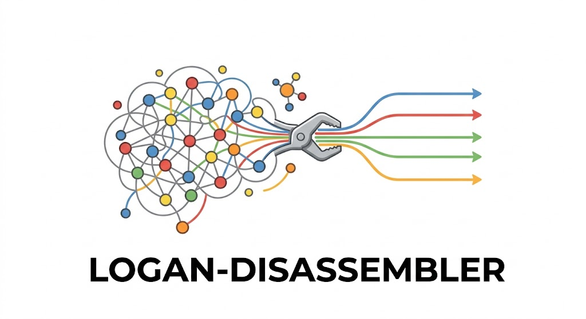

<p align="center">
  
</p>

# disassembler

Stream [Logan](https://github.com/IndexThePlanet/Logan) cDBG unitigs from S3, anchor a
reference coding sequence against them on the fly, walk the local subgraph, and reconstruct
the full-length coding haplotypes present in the sample without collapsing intra-host
variation.

This repository is a decoupled extraction of the path-walking component from
[`nekrut/logan-hypyaeon`](https://github.com/nekrut/logan-hypyaeon). It carries only the
pieces needed to go from an SRA accession list plus a query gene to reconstructed haplotypes.
The planetary-scan orchestration, HyphAeon neural selection suite, Galaxy/kmindex candidate
triage, and Roland PLM branch are intentionally left behind.

## What it does

For each SRA accession, given a reference CDS:

1. **Stream** the compressed unitig file from `s3://logan-pub/u/<ACC>/<ACC>.unitigs.fa.zst`
   directly into memory, rejecting oversized accessions on `Content-Length` first.
2. **Parse** the BCALM2 FASTA in a single streaming pass into a compact CSR graph
   (adjacency + `ka:f` abundance + 2-bit sequences, ~43 MB for a 1.28M-unitig accession).
3. **Anchor** the query by canonical k-mer containment (k=21), replacing BLAST.
4. **Extract** the 5-hop neighbourhood around the anchors as a local GFA.
5. **Align** the reference through the local graph with `GraphAligner -x dbg`.
6. **Stitch** the walked path into a primary haplotype, optionally **prune** reference-bias
   error branches and re-align, **prefer** the majority allele at biallelic sites, and
   **emit** intra-host alternative haplotypes to a separate file.
7. Write `reconstructed.fasta`, `alt_haplotypes.fasta`, `bubbles.json`, and a summary JSON.

## Layout

```
walker/     logan-walker: the native Rust engine (the product)
python/     logan_path_walker.py (reference prototype) + build_walker_codon_msa.py (downstream codon MSA)
queries/    reference coding sequences (pfcrt, hiv1_pol, 25 planetary markers, master panel)
bench/      golden-truth fixtures, verify/capture harness, fork-loss measurement, k-mer sensitivity sim
docs/       design plan, as-built notes, the variance-loss investigation, upstream context
```

## Build and run

```bash
# GraphAligner must be on PATH (bioconda). k-mer anchoring replaces BLAST; MAFFT is only for
# the downstream codon MSA in python/.
cd walker
cargo build --release

./target/release/logan-walker \
  -a SRR8209082 \
  -q ../queries/query_hiv1_pol.fasta \
  -o out -f out/reconstructed.fasta
```

Reproduce the old one-haplotype-per-accession behaviour (matches the golden fixtures) with
`--prune-frac 0.0 --no-prefer-majority --no-emit-alts`.

## Provenance and status

The walker is `logan-hypyaeon` PR #4 (`Haplotype recovery`), which layered intra-accession
variant recovery on top of the PR #3 Rust port. Both `stages::variants` (default) and the
upstream `stages::detour` are present and selectable via `--alt-engine`; `docs/` records why
`variants` is the default. Concordance: the Rust primary is byte-identical to
`bench/golden/ERR2028820.pfcrt.primary.fasta` under old-behaviour flags. Offline unit tests
pass (128); network- and data-dependent tests are `#[ignore]` by default.

See `docs/issue_intra_accession_variance_lost.md` for the central methodological finding: the
reference-matching-minority-allele bias, its measurement, and the fix.

## Credits

The Rust walker and intra-host haplotype-recovery method originate from `logan-hypyaeon` PR #4, authored by Andrew ([@as042](https://github.com/as042)), building on the PR #3 Rust port. See `NOTICE` and `docs/` for full provenance.

## Intra-host SNP VCF

`--emit-vcf` writes `<out-dir>/<accession>.vcf` alongside the primary: the on-path
biallelic sites (intra-host SNPs) with their k-mer-coverage frequency, in query
coordinates (`CHROM` = gene, `POS` = 1-based position in the CDS). The primary FASTA is
unchanged. Because every accession is called against the same gene, the VCFs share a
coordinate frame and `bcftools merge` yields a sites x samples frequency matrix. Frequencies
are `ka:f` ratios, a proxy for allele frequency, and are per-site, not phased.
