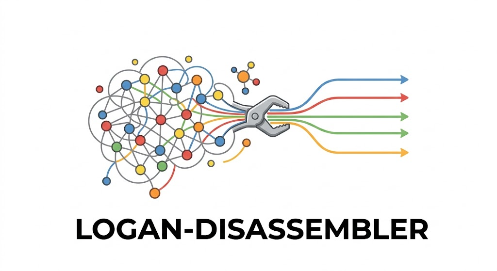

<p align="center">
  
</p>

# disassembler

Reconstruct the coding haplotypes of a gene across thousands of SRA runs, straight from the
[Logan](https://github.com/IndexThePlanet/Logan) assemblies of the whole SRA, and turn them into
a codon alignment and a phylogeny.

Given a reference coding sequence, disassembler finds the runs that carry the gene, recovers the
gene's sequence in each run, and aligns the results in frame. It has two routes:

- **The walker route** (kmindex, then `logan-walker`). A
  [kmindex](https://github.com/tlemane/kmindex) search names the candidate runs. For each run,
  `logan-walker` streams Logan's unitig graph from S3, anchors the reference by shared k-mers,
  walks the local subgraph with GraphAligner, and reconstructs the full-length gene. It also
  recovers intra-host alternative alleles and can report them as VCFs or one long SNV table.
  The sequence it publishes is a majority-consensus path, not a phased haplotype: where a
  sample holds two strains differing at sites the graph does not link, the walker says so with
  `mixed=1` in the FASTA header rather than presenting the combination as clonal.
- **The tiler route** (LexicMap, then the tiler). A
  [LexicMap](https://github.com/IndexThePlanet/LexicMap) search of Logan's contigs is tiled
  onto the reference, checked for premature stop codons, sorted into
  clean and flagged tiers, and collapsed into unique haplotypes. It is much faster, because it
  never downloads a unitig graph, but it projects each run onto the reference rather than
  walking a haplotype, and it has no intra-host variants.

Both routes can thin near-duplicate haplotypes with a k-mer diversity sieve, and both end in a
reference-guided codon MSA (MAFFT) and a FastTree tree.

## Install

**Bioconda** (Linux):

```bash
conda install -c conda-forge -c bioconda disassembler
```

This installs the `disassembler` CLI together with `logan-walker`, `kmer-diversity-sieve`,
GraphAligner, MAFFT and FastTree. See [`docs/packaging.md`](docs/packaging.md).

**Galaxy:** six tool wrappers are being contributed to the IUC, to publish on the Tool Shed as
`suite_disassembler`. See [`docs/galaxy.md`](docs/galaxy.md) for what each one wraps.

**From source:**

```bash
git clone --recurse-submodules https://github.com/nekrut/disassembler
cd disassembler
conda env create -f environment.yml && conda activate disassembler   # pip install -e . included
(cd walker && cargo build --release)                                # needs Rust (rustup.rs)
(cd extern/kmer-diversity-sieve && make serial)                     # only for --sieve
```

`disassembler` finds `logan-walker` and the sieve on `PATH`, through `DISASSEMBLER_WALKER_BIN`
and `DISASSEMBLER_SIEVE_BIN`, or in the source tree's build locations.

## Quick start

```bash
# One accession through the walker
disassembler walk -a SRR8209082 -q queries/query_hiv1_pol.fasta -o out -f out/hiv1_pol.fasta

# Accessions to a codon alignment and tree, with intra-host SNVs
disassembler reconstruct -l accessions.txt -q queries/markers/zika_ns5.fasta -o out/zika \
    --emit-snv-table

# A kmindex search (shard JSONs from Galaxy) to candidate lists, then a cohort
disassembler harvest --history-id <HISTORY_ID> --collection-id <COLLECTION_ID> -o candidates/
disassembler stratify -o candidates/ --score-bin 0.5:1.01:100
disassembler reconstruct -l candidates/zika_ns5.bins.txt -q queries/markers/zika_ns5.fasta -o out/zika

# A LexicMap search table to a tiled cohort, codon alignment and tree
disassembler from-lexicmap -q queries/query_hiv1_pol.fasta -f hiv1_pol_lexicmap.tsv.gz -o out/hiv1_pol
```

`queries/` holds reference CDSs to start from: PfCRT, HIV-1 *pol* and 26 marker genes under
`queries/markers/`. **One gene per `-q`**: the walker keeps one primary per accession, so a
pool holding two different genes reports only one of them. Several references are fine when
they are strains of the same gene, as `panels/sarscov2_spike_11strains.fa` is. See
[`queries/README.md`](queries/README.md) and [`panels/README.md`](panels/README.md).

## What comes out

A walk writes the primary haplotype per accession, the intra-host alternatives, the bubbles,
a row per accession that produced nothing, and a summary; `--emit-vcf` and `--emit-snv-table`
add the variant tables. The headers carry the numbers you need to decide whether to trust a
record:

```text
>SRR8209082_primary cov=1.000 pident=97.5 nodes=2479 ka=16859.3 vaf=1.00 min_vaf=0.690
>SRR8209082_alt1 cov=1.000 inherited_pident=97.5 nodes=2479 vaf=0.310 alt_kaf=3600.0 primary_vaf=0.690 fork=49624+ alt_node=49763+ detour=31 dlen=+0 span=1
```

`min_vaf=0.690` says the rarest allele this sequence carries was 69% of its fork, so the
primary is the majority at every site it passed. A clonal isolate reads `min_vaf=1.000`, and a
primary that combines alleles from two or more unlinked sites is tagged ` mixed=1`. (`vaf=` on
a primary is the constant 1.0 that earlier releases carried; `min_vaf=` is the measured one.)
The `alt1` record is the 31% allele at that same fork, written as its own full-length sequence
rather than as a coordinate.

`--emit-snv-table` writes one row per (accession, site, allele), which is the form that scales
to a cohort:

```text
gene      pos   ref  alt  accession   af      ka_alt  ka_ref  fork   ka_saturated  block
hiv1_pol  2451  G    A    SRR8209082  0.3103  3600.0  8000.0  49624  0
```

Every stage also writes a `summary.json` to the same contract
([`docs/summaries.md`](docs/summaries.md)), so a workflow can branch on the outcome without
parsing logs:

```json
{"acc": "SRR8209082", "status": "success", "subgraph_fraction": 0.424142,
 "provisional": true, "bias_uncorrected": false, "snv_sites": 1, "alts": 1,
 "prune": {"outcome": "applied", "depth": 15000.0, "floor": 150.0,
           "unitigs": 34582, "unitigs_kept": 6946}}
```

`provisional: true` here means the gene's neighbourhood is unusually tangled (42% of this
accession's whole graph), which is the walker saying the walk was ambiguous rather than that it
failed. A worked cohort, from VCFs to a site-by-accession matrix, is in
[`docs/examples/vcf_example.md`](docs/examples/vcf_example.md).

## Commands

| command | does | docs |
|---|---|---|
| `harvest` | merge kmindex shard JSONs into per-target accession lists and scores | [`kmindex.md`](docs/kmindex.md) |
| `stratify` | sample a cohort from a harvest by score bin | [`kmindex.md`](docs/kmindex.md) |
| `fetch` | download unitig files into a local cache for offline runs | [`walker.md`](docs/walker.md#offline-cache) |
| `walk` | run `logan-walker`: reconstruct haplotypes from Logan unitigs | [`walker.md`](docs/walker.md) |
| `tile` | tile a LexicMap search into a codon-checked cohort | [`tiler.md`](docs/tiler.md) |
| `sieve` | thin near-duplicate haplotypes | [`sieve.md`](docs/sieve.md) |
| `msa` | reference-guided codon MSA and FastTree tree | [`codon_msa.md`](docs/codon_msa.md) |
| `reconstruct` | walk, then optional sieve, then msa | [`codon_msa.md`](docs/codon_msa.md#disassembler-reconstruct) |
| `from-kmindex` | harvest, optional stratify, then reconstruct | [`kmindex.md`](docs/kmindex.md#disassembler-from-kmindex) |
| `from-lexicmap` | tile, then optional sieve, then msa | [`tiler.md`](docs/tiler.md#from-lexicmap) |

Every command has `--help`. The composites group their options by stage and pass anything after
a literal `--` to the walker.

Every input file (FASTA references and haplotypes, accession lists, LexicMap tables, kmindex
shards) can be plain or gzip-compressed. Compression is recognised from the file's first bytes,
not its name, so a Galaxy `dataset_<id>.dat` works either way, and so does a pipe such as
`<(zcat hits.tsv.gz)`. zstd-compressed input is refused with a message; decompress it first.

## Documentation

[`docs/README.md`](docs/README.md) is the index. In short:

How to use it:

- [`docs/walker.md`](docs/walker.md): what `logan-walker` does, how to run it, multi-anchor
  mode and offline caching, with every flag, output and exit code in
  [`docs/walker_reference.md`](docs/walker_reference.md)
- [`docs/kmindex.md`](docs/kmindex.md): `harvest`, `stratify` and `from-kmindex`
- [`docs/tiler.md`](docs/tiler.md): the tiler route
- [`docs/sieve.md`](docs/sieve.md): diversity thinning and how to choose its threshold
- [`docs/codon_msa.md`](docs/codon_msa.md): the codon MSA and tree, and `reconstruct`
- [`docs/examples/vcf_example.md`](docs/examples/vcf_example.md): intra-host SNVs on a Zika
  cohort, from VCF to the long table and DuckDB
- [`docs/summaries.md`](docs/summaries.md): the summary JSON every stage writes, and its
  schema versioning
- [`docs/troubleshooting.md`](docs/troubleshooting.md): failure modes by symptom
- [`docs/galaxy.md`](docs/galaxy.md) and [`docs/packaging.md`](docs/packaging.md): Galaxy
  tools, Bioconda packages and releases

Why it works the way it does:

- [`docs/notes/contigs_vs_unitigs.md`](docs/notes/contigs_vs_unitigs.md): why the walker uses
  unitigs rather than Logan's contigs
- [`docs/notes/intra_accession_variance.md`](docs/notes/intra_accession_variance.md):
  the reference-matching minority allele bias, the pruning and majority-preference defaults
  that correct it, and what they still leave behind
- [`docs/notes/graphaligner_end_clipping.md`](docs/notes/graphaligner_end_clipping.md): why
  GraphAligner is pinned to 1.0.17b
- [`docs/notes/sieve_calibration.md`](docs/notes/sieve_calibration.md): the sieve calibration
  study
- [`bench/`](bench/README.md): the golden concordance gate and the k-mer sensitivity simulation

## Repository layout

```text
src/disassembler/   the Python package and the `disassembler` CLI (cmd/ holds one module per command)
walker/             logan-walker, the Rust walker (see walker/README.md)
extern/             kmer-diversity-sieve, as a git submodule
queries/            reference CDSs (see queries/README.md)
panels/             multi-strain reference panels for multi-anchor runs (see panels/README.md)
bench/              golden fixtures and gate, k-mer sensitivity simulation, accession lists
docs/               user and design documentation
tests/              Python tests
```

## Tests

```bash
(cd walker && cargo test --release)          # offline; network tests are #[ignore]
for t in tests/test_*.py; do python "$t"; done
bash tests/test_sieve.sh                      # needs the sieve submodule
bench/check_golden.sh                         # needs GraphAligner 1.0.17b and network
```

## Credits and license

`logan-walker` and the intra-host haplotype recovery method are by Andrew
([@as042](https://github.com/as042)). The diversity sieve is
[kmer-diversity-sieve](https://github.com/stevenweaver/kmer-diversity-sieve). See
[`NOTICE`](NOTICE). MIT licensed; see [`LICENSE`](LICENSE).
