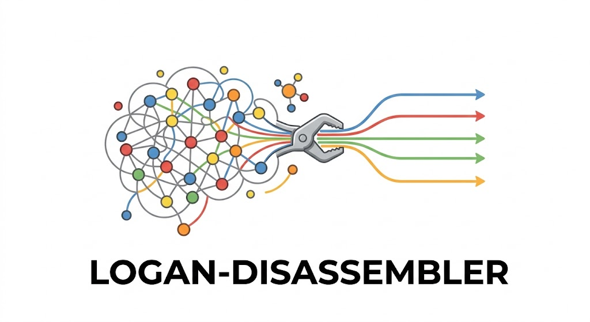

<p align="center">
  
</p>

# disassembler

Reconstruct the coding haplotypes of a gene across thousands of SRA runs, straight from the
[Logan](https://github.com/IndexThePlanet/Logan) assemblies of the whole SRA, and turn them into
a codon alignment and a phylogeny.

Given a reference coding sequence, disassembler finds the runs that carry the gene, recovers the
gene's sequence in each run, and aligns the results in frame. It has two routes:

- **The walker route** (kmindex, then `logan-walker`). A
  [kmindex](https://github.com/tlemane/kmindex) search names the candidate runs. For each run,
  `logan-walker` streams Logan's unitig graph from S3, anchors the reference by shared k-mers,
  walks the local subgraph with GraphAligner, and reconstructs the full-length haplotype. It also
  recovers intra-host alternative alleles and can report them as VCFs or one long SNV table.
- **The LexicMap route.** A [LexicMap](https://github.com/IndexThePlanet/LexicMap) search of
  Logan's contigs is tiled onto the reference, checked for premature stop codons, sorted into
  clean and flagged tiers, and collapsed into unique haplotypes. It is much faster, because it
  never downloads a unitig graph, but it projects each run onto the reference rather than
  walking a haplotype, and it has no intra-host variants.

Both routes can thin near-duplicate haplotypes with a k-mer diversity sieve, and both end in a
reference-guided codon MSA (MAFFT) and a FastTree tree.

## Install

**Bioconda** (Linux):

```bash
conda install -c conda-forge -c bioconda disassembler
```

This installs the `disassembler` CLI together with `logan-walker`, `kmer-diversity-sieve`,
GraphAligner, MAFFT and FastTree. See [`docs/packaging.md`](docs/packaging.md).

**Galaxy:** the tools are under review in
[galaxyproject/tools-iuc#8800](https://github.com/galaxyproject/tools-iuc/pull/8800). See
[`docs/galaxy.md`](docs/galaxy.md).

**From source:**

```bash
git clone --recurse-submodules https://github.com/nekrut/disassembler
cd disassembler
conda env create -f environment.yml && conda activate disassembler   # pip install -e . included
(cd walker && cargo build --release)                                # needs Rust (rustup.rs)
(cd extern/kmer-diversity-sieve && make serial)                     # only for --sieve
```

`disassembler` finds `logan-walker` and the sieve on `PATH`, through `DISASSEMBLER_WALKER_BIN`
and `DISASSEMBLER_SIEVE_BIN`, or in the source tree's build locations.

## Quick start

```bash
# One accession through the walker
disassembler walker -a SRR8209082 -q queries/query_hiv1_pol.fasta -o out -f out/hiv1_pol.fasta

# Accessions to a codon alignment and tree, with intra-host SNVs
disassembler reconstruct -l accessions.txt -q queries/markers/zika_ns5.fasta -o out/zika \
    --emit-snv-table

# A kmindex search (shard JSONs from Galaxy) to candidate lists, then a cohort
disassembler harvest --history-id <HISTORY_ID> --collection-id <COLLECTION_ID> -o candidates/
disassembler stratify -o candidates/ --score-bin 0.5:1.01:100
disassembler reconstruct -l candidates/zika_ns5.bins.txt -q queries/markers/zika_ns5.fasta -o out/zika

# A LexicMap search table to a tiled cohort, codon alignment and tree
disassembler from-lexicmap -q queries/query_hiv1_pol.fasta -f hiv1_pol_lexicmap.tsv.gz -o out/hiv1_pol
```

`queries/` holds reference CDSs to start from: PfCRT, HIV-1 *pol*, 26 marker genes under
`queries/markers/`, and a 160-record panel.

## Commands

| command | does | docs |
|---|---|---|
| `harvest` | merge kmindex shard JSONs into per-target accession lists and scores | [`kmindex.md`](docs/kmindex.md) |
| `stratify` | sample a cohort from a harvest by score bin | [`kmindex.md`](docs/kmindex.md) |
| `fetch` | download unitig files into a local cache for offline runs | [`walker.md`](docs/walker.md#offline-cache) |
| `walker` | run `logan-walker`: reconstruct haplotypes from Logan unitigs | [`walker.md`](docs/walker.md) |
| `lexicmap` | tile a LexicMap search into a codon-checked cohort | [`lexicmap.md`](docs/lexicmap.md) |
| `sieve` | thin near-duplicate haplotypes | [`sieve.md`](docs/sieve.md) |
| `msa` | reference-guided codon MSA and FastTree tree | [`codon_msa.md`](docs/codon_msa.md) |
| `reconstruct` | walker, then optional sieve, then msa | [`codon_msa.md`](docs/codon_msa.md#disassembler-reconstruct) |
| `from-kmindex` | harvest, optional stratify, then reconstruct | [`kmindex.md`](docs/kmindex.md#disassembler-from-kmindex) |
| `from-lexicmap` | lexicmap, then optional sieve, then msa | [`lexicmap.md`](docs/lexicmap.md#from-lexicmap) |

Every command has `--help`. The composites group their options by stage and pass anything after
a literal `--` to the walker.

Every input file (FASTA references and haplotypes, accession lists, LexicMap tables, kmindex
shards) can be plain or gzip-compressed. Compression is recognised from the file's first bytes,
not its name, so a Galaxy `dataset_<id>.dat` works either way, and so does a pipe such as
`<(zcat hits.tsv.gz)`. zstd-compressed input is refused with a message; decompress it first.

## Documentation

How to use it:

- [`docs/walker.md`](docs/walker.md): what `logan-walker` does, multi-anchor mode, outputs,
  offline caching, memory, and the full option reference
- [`docs/kmindex.md`](docs/kmindex.md): `harvest`, `stratify` and `from-kmindex`
- [`docs/lexicmap.md`](docs/lexicmap.md): the LexicMap route
- [`docs/sieve.md`](docs/sieve.md): diversity thinning and how to choose its threshold
- [`docs/codon_msa.md`](docs/codon_msa.md): the codon MSA and tree, and `reconstruct`
- [`docs/vcf_example.md`](docs/vcf_example.md): intra-host SNVs on a Zika cohort, from VCF to
  the long table and DuckDB
- [`docs/galaxy.md`](docs/galaxy.md) and [`docs/packaging.md`](docs/packaging.md): Galaxy
  tools, Bioconda packages and releases

Why it works the way it does:

- [`docs/contigs_vs_unitigs.md`](docs/contigs_vs_unitigs.md): why the walker uses unitigs
  rather than Logan's contigs
- [`docs/issue_intra_accession_variance_lost.md`](docs/issue_intra_accession_variance_lost.md):
  the reference-matching minority allele bias, and the pruning and majority-preference defaults
  that correct it
- [`docs/issue_graphaligner_end_clipping.md`](docs/issue_graphaligner_end_clipping.md): why
  GraphAligner is pinned to 1.0.17b
- [`docs/issue_sieve_calibration.md`](docs/issue_sieve_calibration.md): the sieve calibration
  study
- [`bench/`](bench/README.md): the golden concordance gate and the k-mer sensitivity simulation

## Repository layout

```
src/disassembler/   the Python package and the `disassembler` CLI (cmd/ holds one module per command)
walker/             logan-walker, the Rust walker (see walker/README.md)
extern/             kmer-diversity-sieve, as a git submodule
queries/            reference CDSs
panels/             multi-strain reference panels for multi-anchor runs
bench/              golden fixtures and gate, k-mer sensitivity simulation, accession lists
docs/               user and design documentation
tests/              Python tests
```

## Tests

```bash
(cd walker && cargo test --release)          # offline; network tests are #[ignore]
for t in tests/test_*.py; do python "$t"; done
bash tests/test_sieve.sh                      # needs the sieve submodule
bench/check_golden.sh                         # needs GraphAligner 1.0.17b and network
```

## Credits and license

`logan-walker` and the intra-host haplotype recovery method are by Andrew
([@as042](https://github.com/as042)). The diversity sieve is
[kmer-diversity-sieve](https://github.com/stevenweaver/kmer-diversity-sieve). See
[`NOTICE`](NOTICE). MIT licensed; see [`LICENSE`](LICENSE).
