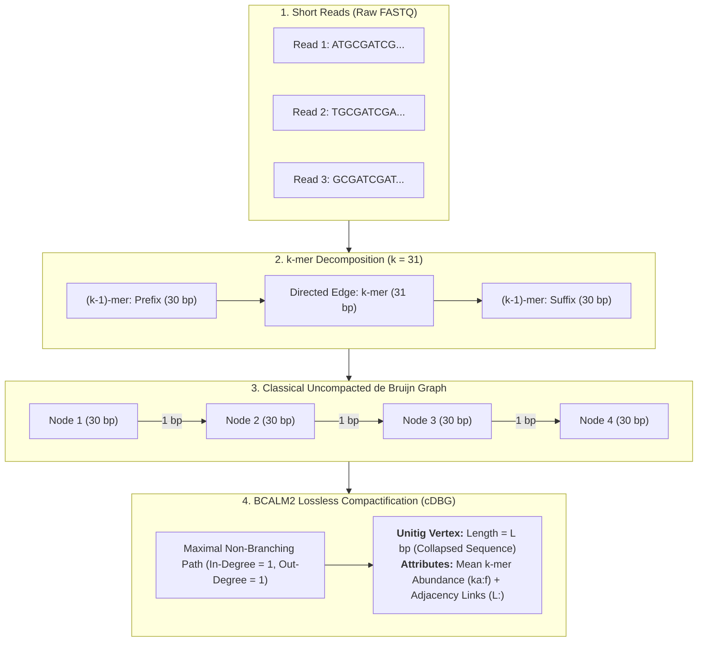
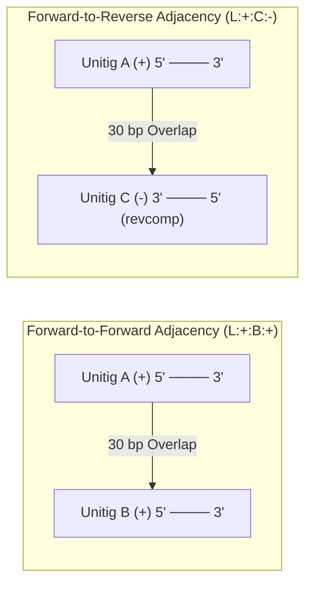
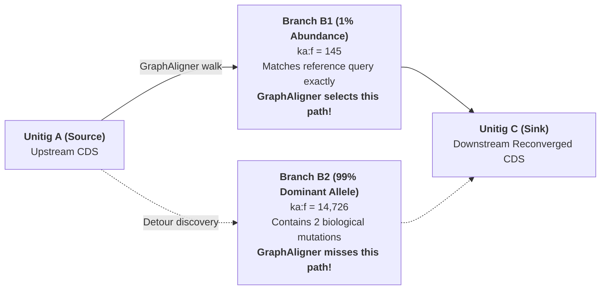

> **Imported explainer** of unitig graph topology, from the upstream README. The biology is
> current; some tooling references are historical (e.g. section 2.5's `detour` engine has been
> retired in favour of `stages::variants`, and paths like `work/benchmark/` refer to the upstream
> layout). Current behaviour: [`../README.md`](../README.md).

## 2. Unitig Derivation, Graph Topology & BCALM2 Header Anatomy

### 2.1 From Raw Reads to Compacted de Bruijn Graph (cDBG) Unitigs
Understanding how unitigs are derived reveals why they represent the ultimate evolutionary substrate for planetary sequence mining. Traditional de novo genome assemblers attempt to resolve an uncompacted de Bruijn graph into linear scaffolds (contigs), systematically collapsing polymorphic variation, heterozygous sites, and intra-host quasispecies into an artificial consensus:



Mathematically, given an uncompacted de Bruijn graph $\mathcal{G} = (\mathcal{V}, \mathcal{E})$ where vertices $\mathcal{V}$ are canonical $(k-1)$-mers and directed edges $\mathcal{E}$ are observed $k$-mers, the vast majority of the graph consists of simple, linear paths where every intermediate vertex has $\text{in-degree}(v) = 1$ and $\text{out-degree}(v) = 1$. A **unitig** is defined as a maximal simple path:
$$\mathcal{P} = (v_1, v_2, \dots, v_m) \quad \text{such that} \quad \forall i \in \{2, \dots, m-1\}, \; \text{in-deg}(v_i) = \text{out-deg}(v_i) = 1$$
BCALM2 compacts each such path into a single vertex of sequence length $L = m + k - 1$ bp. Vertices where branching occurs ($\text{in-deg} > 1$ or $\text{out-deg} > 1$) terminate the path, forming unitig boundaries. This compactification is **completely lossless**: every observed $k$-mer, its mean coverage depth, and its exact topological connectivity to neighboring paths are strictly preserved, while compressing graph storage by **15- to 33-fold**.

---

### 2.2 The Inviolable Axiom: NEVER USE CONTIGS (Contigs Flatten Variation)

> [!CAUTION]
> **Contigs aggressively collapse bubbles, prune tips, and pick majority paths.**  
> In planetary evolutionary selection profiling, using assembled contigs (`s3://logan-pub/c/`) is mathematically destructive. Our pipeline operates **strictly and exclusively on uncollapsed unitigs** (`s3://logan-pub/u/`).

Traditional de novo assemblers (e.g. Minia3, SPAdes) are designed to produce single linear consensus sequences for genome cataloging. To achieve this, their graph reduction heuristics systematically destroy biological diversity:
1. **Bubble Popping:** When heterozygous loci, sub-clonal variants, or intra-host viral quasispecies create an alternate branch (e.g., a 79% major allele and a 21% drug-resistant minor allele), the assembler pops the bubble and discards the minor branch entirely, erasing within-host evolutionary dynamics.
2. **Tip Clipping:** Dead-end branches originating from sequencing errors or rare genuine mutations are indiscriminately pruned.
3. **Chimeric Scaffold Stitching:** When repetitive regions or homologous operons connect multiple paths, the assembler picks an arbitrary majority walk, manufacturing chimeric artificial recombinants.

Unitigs, by mathematical definition, **never cross a branch point**. Every alternative allele, sub-population divergence, and low-frequency variant is preserved as an independent unitig node with its exact observed $k$-mer abundance (`ka:f`) and topological adjacency links (`L:`). Unitigs are the only lossless representation of the underlying Sequence Read Archive.

| Property | Compacted Unitigs (`.unitigs.fa.zst`) | Assembled Contigs (`.contigs.fa.zst`) | Evolutionary Impact |
| :--- | :--- | :--- | :--- |
| **Branch Points** | Preserved (strictly halts at junctions) | Collapsed (arbitrary majority path chosen) | Preserves full quasispecies topology |
| **Minor Alleles** | Retained with independent `ka:f` | Destroyed / Pruned | Recovers sub-clonal resistance mutations |
| **Heterozygosity** | Explicitly represented as graph bubbles | Flattened to single consensus nucleotide | Eliminates artificial homozygous calls |
| **Chimerism** | Zero (no heuristic bridging across repeats) | High (assembler bridges ambiguous repeats) | Eliminates false-positive positive selection |
| **Pipeline Status** | **MANDATORY GROUND-TRUTH** | **FORBIDDEN** | Mathematically rigorous selection inference |

---

### 2.3 BCALM2 FASTA Header Anatomy
In Logan, unitigs are emitted in compressed BCALM2 FASTA format (`.unitigs.fa.zst`). An authentic header from an empirical SRA accession (`ERR2028820`) illustrates the exact token grammar:

```text
>ERR2028820_14 ka:f:9.0   L:-:11:- L:-:57586:-  L:+:19:+ 
AAAAAAAAAAAAAACATAAAACAAAAAATCA
```

Every header line encodes three distinct information layers:
1. **Identifier Token (`>ERR2028820_14`):** Composed of `{accession}_{unitig_id}`. In local graph operations, the accession prefix is stripped, leaving the bare numeric identifier (`14`).
2. **Abundance Token (`ka:f:9.0`):** The floating-point mean $k$-mer abundance across all $(L - k + 1)$ constituent $k$-mers in the unitig. Single-pass sequencing errors typically exhibit $ka:f \le 2.0$. Authentic genomic regions or viral populations exhibit high coverage ($ka:f \ge 5.0$ to $ka:f > 2{,}000.0$).
3. **Topological Adjacency Link Tokens (`L:<strand1>:<target_id>:<strand2>`):** Each link token represents an exact $(k-1)$ overlap ($30\text{ bp}$) connecting the current unitig to a neighbor in the graph:
   - `strand1` ($\pm$): Polarity leaving the current unitig (`+` departs the $3'$ end; `-` departs the $5'$ reverse-complement end).
   - `target_id`: The bare numeric identifier of the downstream unitig (e.g. `11`, `57586`, `19`).
   - `strand2` ($\pm$): Polarity entering the target unitig (`+` enters the $5'$ end; `-` enters the $3'$ reverse-complement end).

---

### 2.4 Graph Topology & Orientation-Aware Adjacency Links
Because DNA is double-stranded, adjacency links must preserve strandedness. A link $L:s_1:T:s_2$ specifies how the terminal $(k-1)$-mer of unitig $S$ overlaps with the initial $(k-1)$-mer of unitig $T$:



---

### 2.5 Closed-Loop Multi-Haplotype Detour Splicing (`-H many`)

> **Note:** this section describes the retired `detour` engine (`-H many`, `--max-detour-hops`,
> `_detour_N` records), imported from the upstream README for the reference-bias background it
> explains. That engine has been removed; intra-host alleles are now recovered by
> `stages::variants` (writing `alt_haplotypes.fasta` / `--emit-vcf`), which the variance
> investigation showed wins on gap rate and VAF labelling. The reference-bias problem below is
> real and still what the current stage addresses.

A critical discovery in graph-based sequence extraction is that **GraphAligner exhibits intrinsic reference bias**. Because GraphAligner scores candidate paths against the reference query sequence, it prefers a low-abundance (e.g. 1%) reference-matching path over a divergent 99% majority allele that contains two true biological substitutions:



To eliminate reference bias and capture complete intra-host quasispecies, `stages/detour.rs` implements a closed-loop multi-haplotype detour engine:
1. **Base Alignment Walk:** GraphAligner identifies an initial backbone path $P = (v_1, v_2, \dots, v_n)$.
2. **Oriented Forward BFS:** For every node $v_i$ along the backbone, an oriented breadth-first search explores alternative forward branches up to $\le 8$ hops (`--max-detour-hops`), searching for reconvergences to downstream backbone nodes $v_j$ where $j > i+1$.
3. **Combinatorial Splicing:** Every closed detour is spliced into the backbone sequence, reconstituting the uncollapsed full-length coding haplotype.
4. **Abundance-Weighted Re-ranking:** Constituent unitig $k$-mer abundances (`ka:f`) are weighted by length to compute the mean abundance of each phased sequence:
   $$\overline{ka}(\text{Hap}) = \frac{\sum_{u \in \text{Hap}} (L_u - k + 1) \cdot ka(u)}{\sum_{u \in \text{Hap}} (L_u - k + 1)}$$
   All distinct haplotypes are sorted descending by $\overline{ka}$. The highest-abundance sequence is promoted to `_major`, the reference-matching path is preserved as `_primary`, and alternative variants are emitted as `_detour_N`.

**Empirical Live Validation (`SRR8209082`, HIV-1 *pol*):**
- In single mode (`-H one`): Emitted strictly the single primary walked path (`ka=14,543.4`).
- In multi-haplotype mode (`-H many`): Reconstructed **59 distinct full-length in-frame haplotypes** in 0.6 seconds, with the true dominant allele (**`ka=14,726.7`**) promoted to `_major`, superseding the walked path.

---

### 2.6 Calibrated Anchoring Sensitivity ($k=21, min\_shared\_kmers=3$)

To determine the optimal parameters for nucleating local subgraphs from whole-sample graphs, we conducted an exhaustive simulation study comprising **121,500 trials across 4,860 parameter combinations** (`work/benchmark/simulated_kmer_sensitivity/`):

1. **The $k \ge 19$ Specificity Wall:** Across 30,000 unitigs of a complete 4.64 Mbp *E. coli* K-12 background genome, false-positive anchor counts are **identically zero ($FP = 0$)** for all $k \in [19, 21, 25, 27, 31]$, even with $min\_shared\_kmers = 1$. The signal-to-noise ratio is $\infty$.
2. **The $k=31$ Sensitivity Cliff:** At 85% nucleotide identity, $k=31$ anchor recall drops to 7.0%, and full-gene recovery crashes to **24%** (76% of genes lost). At 80% identity, $k=31$ recovery is only **8%**.
3. **The Optimal Operating Point ($k=21, min\_shared\_kmers=3$):** 
   - **Zero false positives** ($FP = 0$, 0 background noise).
   - Extends 100% full-gene recovery down to **80% nucleotide sequence identity** under uniform mutations.
   - When biological catalytic core motifs are preserved, maintains **96–100% recovery down to 60% identity** (versus 48% for $k=31$).

---

