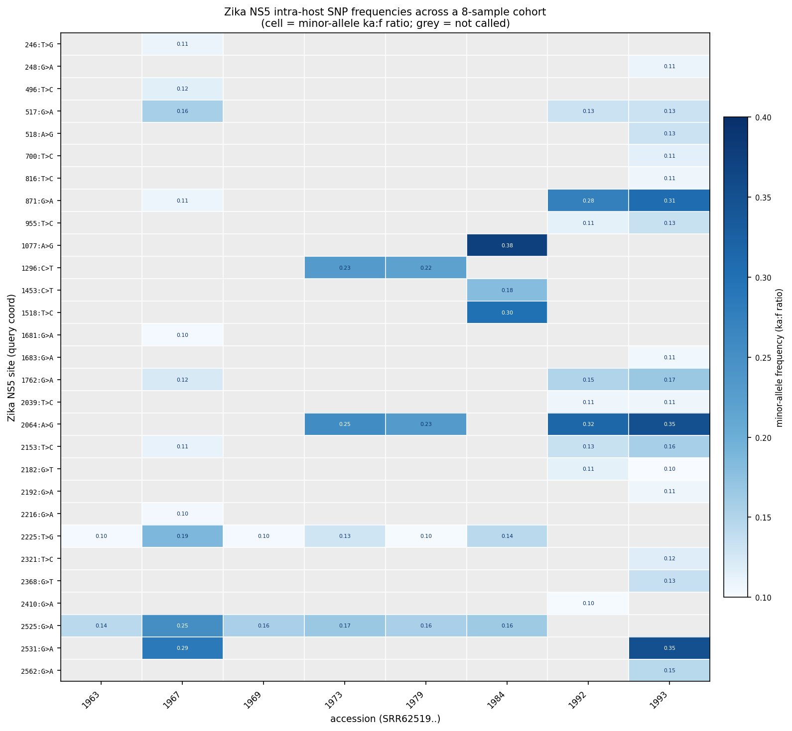

# Intra-host SNP VCF: a worked Zika example

`--emit-vcf` writes the on-path biallelic sites (intra-host SNPs) with their `ka:f` frequency,
in query coordinates. This is that output on the Zika NS5 cohort, plus what it becomes when the
per-accession files are merged. Files referenced here live in
[`examples/zika_ns5/`](examples/zika_ns5/).

## One accession

```bash
logan-walker -a SRR6251967 -q queries/markers/zika_ns5.fasta \
  -o out -f out/primary.fasta --no-emit-alts --emit-vcf
```

produces [`SRR6251967.zika_ns5.vcf`](examples/zika_ns5/SRR6251967.zika_ns5.vcf) — 11 SNPs, each
a fork the walked path passes where both alleles clear the abundance and frequency gates:

```
#CHROM    POS  ID  REF  ALT  QUAL  FILTER  INFO                                     FORMAT       SRR6251967
zika_ns5  246  .   T    G    .     PASS    AF=0.1093;AO=4400.0;RO=25000.0;FORK=...   GT:AF:AO:RO  .:0.1093:4400.0:25000.0
zika_ns5  496  .   T    C    .     PASS    AF=0.1155;AO=3300.0;RO=25000.0;FORK=...   GT:AF:AO:RO  .:0.1155:3300.0:25000.0
zika_ns5  517  .   G    A    .     PASS    AF=0.1564;AO=4800.0;RO=25000.0;FORK=...   GT:AF:AO:RO  .:0.1564:4800.0:25000.0
...
```

`REF` is the query gene's base, `ALT` the minor allele, `AF` its `ka:f` frequency, `AO`/`RO` the
two alleles' `ka:f` coverage, `FORK` the unitig id of the fork. `POS` is 1-based within the
query CDS.

## The cohort, merged

Because every accession is called against the same gene, the coordinate frames match and the
files merge with no reconciliation:

```bash
for f in *.vcf; do bcftools sort $f -Oz -o $f.gz; bcftools index $f.gz; done
bcftools merge -m none *.vcf.gz -o zika_ns5.cohort.merged.vcf
```

That produces the sites x samples frequency table
([`zika_ns5.af_matrix.tsv`](examples/zika_ns5/zika_ns5.af_matrix.tsv), and the merged VCF
[`zika_ns5.cohort.merged.vcf`](examples/zika_ns5/zika_ns5.cohort.merged.vcf)): 29 distinct sites
across 8 samples, of which 12 are seen in two or more samples.

## The matrix



Each cell is a minor-allele frequency; grey means the site was not called in that sample. The
picture is the point of the VCF: it has visible cross-sample structure. Two groups fall out.

- **Sites 2225 and 2525** carry a minor allele in the *same six* samples (SRR6251963, 967, 969,
  973, 979, 984) at 10-25%. Two rows that light up together across the same samples is the
  correlated-column signal that frequency-covariation phasing would run on.
- **Sites 517, 871, 1762, 2064, 2153** cluster in SRR6251992 and 6251993 (and partly 6251973/
  979), a second, largely disjoint set.

A single sample's marginal frequencies cannot say whether two of its sites sit on the same
molecule (see [`issue_intra_accession_variance_lost.md`](issue_intra_accession_variance_lost.md)
section on phasing). But the *covariation of these frequencies across samples* is real linkage
information, and this merged matrix is exactly its input. So the one flag that annotates the
intra-host variation also produces the substrate for exploring cross-sample linkage.

## Caveats, restated

- Frequencies are `ka:f` coverage ratios at a graph fork, a proxy for allele frequency, not
  read counts, and they can be distorted where a unitig is repeat-collapsed.
- The VCF is per-site, not phased: two rows do not assert co-occurrence on one molecule. Both
  caveats are written into every file's `##` header.
- Substitutions only; indel alleles stay in `alt_haplotypes.fasta`.
