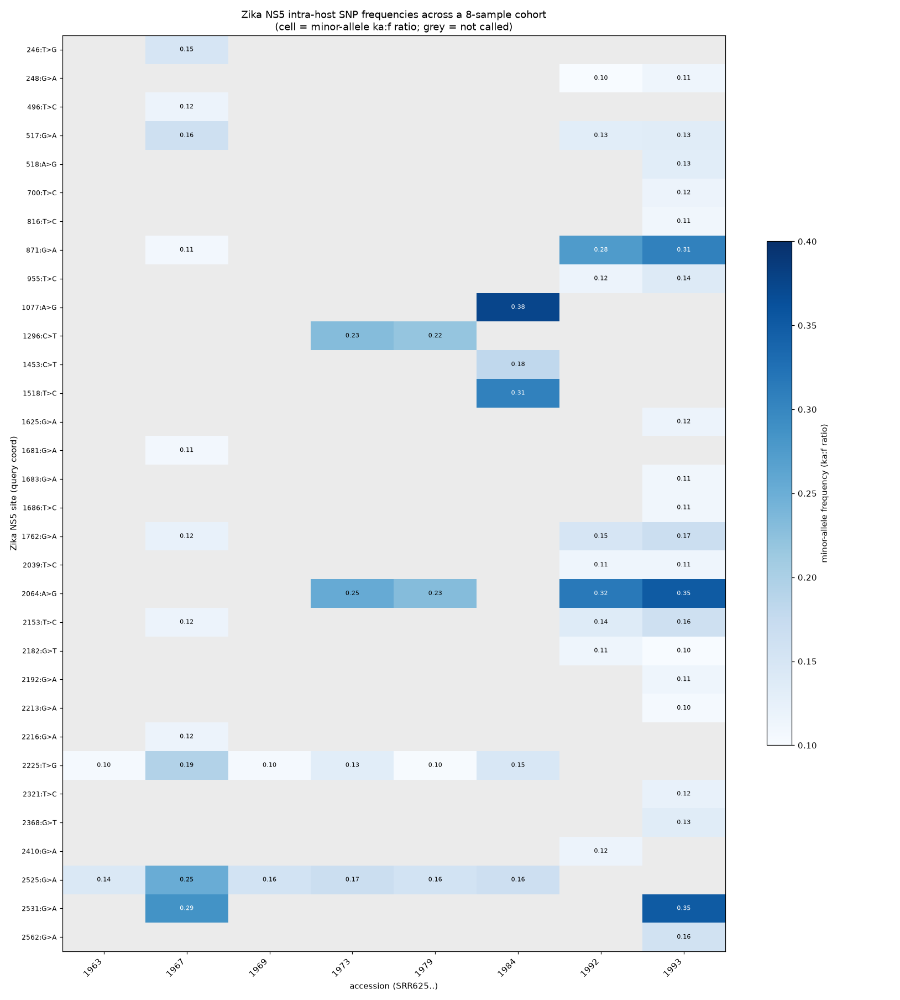

# Intra-host SNP VCF: a worked Zika example

`--emit-vcf` writes the on-path biallelic sites (intra-host SNPs) with their `ka:f` frequency,
in query coordinates. This is that output on the Zika NS5 cohort, plus what it becomes when the
per-accession files are merged. Files referenced here live in
[`examples/zika_ns5/`](examples/zika_ns5/).

## One accession

```bash
logan-walker -a SRR6251967 -q queries/markers/zika_ns5.fasta \
  -o out -f out/primary.fasta --no-emit-alts --emit-vcf
```

produces `out/SRR6251967.vcf` (the walker names VCFs `<accession>.vcf`; the copy committed
here as [`SRR6251967.zika_ns5.vcf`](examples/zika_ns5/SRR6251967.zika_ns5.vcf) was renamed to
record which gene it came from). It holds 11 SNPs, each
a fork the walked path passes where both alleles clear the abundance and frequency gates:

```
#CHROM    POS  ID  REF  ALT  QUAL  FILTER  INFO                                     FORMAT       SRR6251967
zika_ns5  246  .   T    G    .     PASS    AF=0.1093;AO=4400.0;RO=25000.0;FORK=...   GT:AF:AO:RO  .:0.1093:4400.0:25000.0
zika_ns5  496  .   T    C    .     PASS    AF=0.1155;AO=3300.0;RO=25000.0;FORK=...   GT:AF:AO:RO  .:0.1155:3300.0:25000.0
zika_ns5  517  .   G    A    .     PASS    AF=0.1564;AO=4800.0;RO=25000.0;FORK=...   GT:AF:AO:RO  .:0.1564:4800.0:25000.0
...
```

`REF` is the query gene's base. `ALT` is **each sample allele that differs from that base**,
and `AF` is that allele's frequency. Usually the sample's minority allele, but **the majority
allele when the sample's consensus differs from the reference**, in which case `AF` is above
0.5, and **both alleles when neither matches the gene base**, in which case `RO` is 0.0.
`AO`/`RO` are the alleles' `ka:f` coverage, `FORK` the unitig id of the fork. `POS` is 1-based
within the query CDS.

This matters for cohort work: filtering or averaging these frequencies as if they were all
minor-allele frequencies mixes in values above 0.5. Where you want the minor allele
specifically, take `min(af, 1 - af)`.

## The cohort, at scale: the long table

A gene can be matched by millions of SRA runs. A merged multi-sample VCF carries one field per
sample on every line, so at that scale it is a million-column, almost-entirely-empty matrix,
and it does not work. The data is sparse (each accession has a handful of SNP sites) and its two
axes are asymmetric: the site axis is bounded by gene length, the sample axis is unbounded. So
the cohort output is a **long ("tidy") table**, one row per `(accession, site, allele)`, not a
wide matrix.

```bash
logan-walker -l accessions.txt -q queries/markers/zika_ns5.fasta \
  -o out -f out/primary.fasta --emit-snv-table   # writes out/snvs.tsv
```

[`zika_ns5.snvs.tsv`](examples/zika_ns5/zika_ns5.snvs.tsv):

```
gene      pos   ref  alt  accession    af      ka_alt   ka_ref   fork
zika_ns5  1296  C    T    SRR6251979   0.2188  7000.0   25000.0  875541
zika_ns5  2064  A    G    SRR6251979   0.2308  7500.0   25000.0  1315085
...
```

Total rows are the sum of SNPs across accessions, a few per accession, so a million-run gene is
tens of millions of rows, a sub-GB columnar file. Each cluster shard writes its own file; point
DuckDB at the glob (`read_csv_auto('shard_*/snvs.tsv')`) and never materialise a dense matrix.
The two things you actually want are queries over it.

**Per-site summary** (this is what replaces the wide matrix, and it stays compact at any sample
count):

```sql
SELECT pos, ref, alt, count(*) AS n_samples,
       round(avg(af),3) AS mean_af, round(min(af),3) AS min_af, round(max(af),3) AS max_af
FROM read_csv_auto('snvs.tsv', sep='\t')
GROUP BY pos, ref, alt HAVING count(*) >= 2 ORDER BY n_samples DESC;
```

```
 pos  change  n_samples  mean_af
 2225 T>G     6          0.128
 2525 G>A     6          0.173
 2064 A>G     4          0.288
 517  G>A     3          0.140
 ...
```

**Cross-sample co-occurrence** of two sites, the input to frequency-covariation phasing, is a
site-filtered self-join, not a scan of a matrix:

```sql
WITH a AS (SELECT accession FROM snv WHERE pos=2225),
     b AS (SELECT accession FROM snv WHERE pos=2525)
SELECT (SELECT count(*) FROM a JOIN b USING(accession)) AS both;   -- 6 of 6
```

Sites 2225 and 2525 carry a non-reference allele in the *same* six samples: perfect co-occurrence in
this cohort, computed without ever touching the sample axis as columns.

## Small cohorts only: merge and heatmap

For a bounded, curated cohort (tens to a few hundred samples) it is convenient to merge into a
multi-sample VCF and look at the dense matrix directly. **Do not do this at planetary scale:**
use the long table above. On this 8-sample example:

```bash
for f in *.vcf; do bcftools sort $f -Oz -o $f.gz; bcftools index $f.gz; done
bcftools merge -m none *.vcf.gz -o zika_ns5.cohort.merged.vcf
```

produces the sites x samples table
([`zika_ns5.af_matrix.tsv`](examples/zika_ns5/zika_ns5.af_matrix.tsv)) and merged VCF
([`zika_ns5.cohort.merged.vcf`](examples/zika_ns5/zika_ns5.cohort.merged.vcf)): 29 sites across 8
samples, 12 seen in two or more.

## The matrix (small-cohort view)



Each cell is the frequency of the non-reference allele, which is the minor allele at these
sites; grey means the site was not polymorphic in that sample. The
picture is the point of the VCF: it has visible cross-sample structure. Two groups fall out.

- **Sites 2225 and 2525** carry a non-reference allele in the *same six* samples (SRR6251963, 967, 969,
  973, 979, 984) at 10-25%. Two rows that light up together across the same samples is the
  correlated-column signal that frequency-covariation phasing would run on.
- **Sites 517, 871, 1762, 2064, 2153** cluster in SRR6251992 and 6251993 (and partly 6251973/
  979), a second, largely disjoint set.

A single sample's marginal frequencies cannot say whether two of its sites sit on the same
molecule (see [`issue_intra_accession_variance_lost.md`](issue_intra_accession_variance_lost.md)
section on phasing). But the *covariation of these frequencies across samples* is real linkage
information, and this merged matrix is exactly its input. So the one flag that annotates the
intra-host variation also produces the substrate for exploring cross-sample linkage.

## Caveats, restated

- Frequencies are `ka:f` coverage ratios at a graph fork, a proxy for allele frequency, not
  read counts, and they can be distorted where a unitig is repeat-collapsed.
- The VCF is per-site, not phased: two rows do not assert co-occurrence on one molecule. Both
  caveats are written into every file's `##` header.
- Substitutions only; indel alleles stay in `alt_haplotypes.fasta`.

## INFO after a merge

`AF`, `AO`, `RO` and `FORK` are written to both INFO and FORMAT. After `bcftools merge` the
INFO fields hold **one sample's** values, not the cohort's: in the merged example here, a site
whose samples carry 0.1564, 0.132 and 0.1327 reports `AF=0.1327` in INFO. Read per-sample
values from FORMAT and treat merged INFO as unreliable.

## Linked substitutions share a `BLOCK`

An alternative haplotype carrying more than one substitution is now called site by site, and
those rows carry the same `BLOCK` id. That tag matters for interpretation: the `##source`
caveat says two rows do not assert co-occurrence, and for independent rows that is right, but
rows sharing a BLOCK came from one alternative and therefore **do** sit on one molecule. It is
the only co-occurrence this output asserts.

Until 0.2.0 such alleles were dropped from both the VCF and the SNV table entirely, with no
message, so dense variable regions were under-reported precisely where they are most
interesting.

## The `KaSat` filter

From 0.2.0 a row whose fork touches Logan's `ka:f` ceiling of 25,000 is FILTERed `KaSat`
rather than `PASS`. The frequencies on such a row are ratios against a total that is a lower
bound, so `AF` is overstated by an unknown amount; the true depth cannot be recovered from the
unitig file, so the row is published with a flag rather than dropped or silently adjusted.

This matters most on exactly the samples these outputs are for. Deep viral and amplicon runs
sit at the ceiling: the Zika NS5 example in `docs/examples/` has `RO=25000.0` in all 11 of its
rows, and 2,461 of the 2,564 NS5 reference unitigs in that run are at the ceiling.

`bcftools view -f PASS` therefore drops these rows now, where in 0.1.x it kept them unmarked.
That is the intended behaviour: a cohort frequency matrix built from saturated rows is built
from lower bounds. To keep them, filter on `KaSat` explicitly and treat the frequencies as
minima.

### The cohort files here predate the flag

`SRR6251967.zika_ns5.vcf` above was regenerated in 0.2.0 and all 11 of its rows are `KaSat`,
at the same positions and the same frequencies as before: only the flag is new, nothing about
the result changed.

The cohort files beside it (`zika_ns5.snvs.tsv`, `zika_ns5.cohort.merged.vcf`,
`zika_ns5.af_matrix.tsv` and the figure) were produced before the flag existed, by a separate
`bcftools merge` step over all eight accessions. **54 of their 55 rows are at the ceiling**, so
read every frequency in them as a lower bound. To regenerate:

```bash
disassembler walker -l accessions.txt -q queries/markers/zika_ns5.fasta \
    -o out/zika --emit-vcf --emit-snv-table
# then bgzip/index each VCF and `bcftools merge -m none` as the merged file's header records
```
